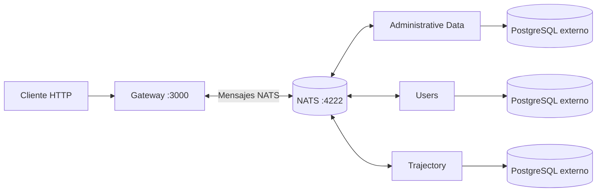

# Plataforma DevOps — Infraestructura y despliegue base

Documentación de la infraestructura Kubernetes del proyecto **CloudComputingDevOps**, correspondiente a la responsabilidad de **Infraestructura y Despliegue Base** (R1.3 y documentación R1.8).

> **Alcance:** este documento describe el despliegue base con Minikube, Helm, NATS y cuatro microservicios. La implementación de CI/CD, runners y el despliegue del frontend pertenecen a otros frentes del proyecto.

> **Integrante 3 (R1.6 / R1.7):** blue-green + Ingress, Alertmanager (3 reglas + notificaciones), pruebas de carga y fallos simulados → guía paso a paso: [`docs/guia-paso-a-paso-integrante-3.md`](docs/guia-paso-a-paso-integrante-3.md).


## 1. Arquitectura



Los cuatro microservicios se ejecutan como `Deployment` de Kubernetes en el namespace `devops`. El Gateway dispone de un `Service` interno `ClusterIP` en el puerto `3000`; NATS dispone de un `Service` interno en el puerto `4222`. Los microservicios de negocio consumen mensajes NATS, por lo que no necesitan un `Service` HTTP propio en la configuración base.

Las bases de datos PostgreSQL son externas al clúster (Supabase, según la configuración del proyecto). El diagrama representa dependencias previstas; la comunicación funcional extremo a extremo debe verificarse con una prueba real.

## 2. Entorno utilizado

| Componente | Configuración utilizada |
| --- | --- |
| Sistema operativo | Ubuntu 22.04.5 LTS, VM Vagrant/VirtualBox |
| Recursos de la VM | 4 vCPU, 12 GB RAM |
| Docker | 29.8.1 |
| Minikube | 1.39.0, driver Docker |
| Kubernetes | 1.37.0 |
| Helm | 3.22.1 |
| Namespace | `devops` |
| Registro de imágenes | GitHub Container Registry (`ghcr.io`) |

Las versiones reflejan el entorno de la práctica; no son necesariamente requisitos mínimos.

## 3. Organización del repositorio

```text
devops-platform/
├── docs/
│   ├── infraestructura.md
│   └── integrante-3.md          # Blue-green, alertas, carga, fallos
├── helm/
│   ├── microservices/           # Incluye gateway blue/green + Ingress
│   └── nats/
├── kubernetes/
│   └── namespace.yaml
├── monitoring/
│   ├── kube-prometheus-stack/ # Prometheus + Alertmanager (3 reglas)
│   └── alertmanager-webhook/  # Receptor de notificaciones
├── scripts/
│   ├── deploy-stack.sh
│   ├── install-monitoring.sh
│   ├── blue-green-switch.sh
│   ├── load/                    # wrk + k6
│   └── failures/                # Escenarios de fallo
├── secrets/examples/            # Plantillas .env (sin secretos reales)
└── README.md
```

> La estructura muestra los archivos relevantes para infraestructura. Pueden existir otros archivos auxiliares generados por Helm.

## 4. Preparación del clúster

Se requiere Docker, Minikube, `kubectl` y Helm instalados en la VM.

Iniciar Minikube y comprobar el nodo:

```bash
minikube start --driver=docker
kubectl get nodes
```

Crear o actualizar el namespace declarativo:

```bash
kubectl apply -f kubernetes/namespace.yaml
kubectl get namespace devops
```

**Nota:** si la VM se reinicia, es posible que Minikube deba iniciarse nuevamente. No es necesario eliminar el clúster.

## 5. Instalar NATS con Helm

Agregar el repositorio oficial de charts:

```bash
helm repo add nats https://nats-io.github.io/k8s/helm/charts/
helm repo update
```

Instalar o actualizar NATS con los valores versionados:

```bash
helm upgrade --install nats nats/nats \
  --namespace devops \
  -f helm/nats/values.yaml \
  --wait \
  --timeout 5m
```

Verificar:

```bash
kubectl get pods -n devops
kubectl get svc -n devops
```

En la práctica, `nats-0` quedó `2/2 Running` y el Service `nats` expuso `4222/TCP` internamente. La dirección de conexión desde los microservicios es:

```dotenv
NATS_SERVERS=nats://nats:4222
```

## 6. Variables de entorno y Secrets

**No subir contraseñas, claves privadas, tokens, archivos `.env` reales ni URLs de conexión con credenciales al repositorio.**

La configuración se divide así:

- **Variables no sensibles:** `helm/microservices/values.yaml`, bajo `services.<servicio>.env`.
- **Variables sensibles:** Kubernetes `Secret`, referenciado desde el Deployment mediante `envFrom.secretRef`.

Crear un directorio privado fuera del repositorio:

```bash
mkdir -p "$HOME/secrets/devops"
chmod 700 "$HOME/secrets" "$HOME/secrets/devops"
umask 077
```

Preparar estos archivos locales con valores reales (sin publicarlos):

**`~/secrets/devops/administrative-data.env`**

```dotenv
DATABASE_URL=REEMPLAZAR_CON_URL_REAL
CLOUDINARY_API_KEY=REEMPLAZAR
CLOUDINARY_API_SECRET=REEMPLAZAR
RESEND_API_KEY=REEMPLAZAR
```

**`~/secrets/devops/users.env`**

```dotenv
DATABASE_URL=REEMPLAZAR_CON_URL_REAL
DATABASE_KEY=REEMPLAZAR
DATABASE_ADMIN_KEY=REEMPLAZAR
CLOUDINARY_API_KEY=REEMPLAZAR
CLOUDINARY_API_SECRET=REEMPLAZAR
```

**`~/secrets/devops/trajectory.env`**

```dotenv
DATABASE_URL=REEMPLAZAR_CON_URL_REAL
```

> Los ejemplos contienen marcadores, no credenciales funcionales. Si el código de cada servicio requiere otras variables, consultar su esquema de validación (`src/config/envs.ts`) y agregarlas en el lugar apropiado. En la práctica, **Administrative Data y Users también exigieron `CLOUDINARY_NAME`**, que se configuró como variable no sensible en los valores de Helm.

Crear o actualizar los Secrets de forma declarativa sin guardar manifiestos con credenciales en Git:

```bash
kubectl create secret generic administrative-data-secrets \
  -n devops \
  --from-env-file="$HOME/secrets/devops/administrative-data.env" \
  --dry-run=client -o yaml | kubectl apply -f -

kubectl create secret generic users-secrets \
  -n devops \
  --from-env-file="$HOME/secrets/devops/users.env" \
  --dry-run=client -o yaml | kubectl apply -f -

kubectl create secret generic trajectory-secrets \
  -n devops \
  --from-env-file="$HOME/secrets/devops/trajectory.env" \
  --dry-run=client -o yaml | kubectl apply -f -
```

Comprobar que existen, **sin imprimir sus valores**:

```bash
kubectl get secrets -n devops
```

Los nombres esperados son `administrative-data-secrets`, `users-secrets` y `trajectory-secrets`. Los Secrets de Kubernetes no deben tratarse como un almacén cifrado por defecto: restringir acceso mediante RBAC y proteger el clúster.

## 7. Imágenes de los microservicios

Las imágenes utilizadas en el primer despliegue fueron:

| Servicio | Imagen |
| --- | --- |
| Gateway | `ghcr.io/cloudcomputingdevops/gateway:sha-d712b92` |
| Administrative Data | `ghcr.io/cloudcomputingdevops/administrative-data-microservice:sha-57cd697` |
| Users | `ghcr.io/cloudcomputingdevops/users-microservice:sha-5ac9c40` |
| Trajectory | `ghcr.io/cloudcomputingdevops/trajectory-microservice:sha-e2ba8e8` |

Los tags `sha-*` corresponden a una versión concreta y deben actualizarse al publicar nuevas imágenes. Si los paquetes de GHCR son privados, será necesario configurar credenciales de descarga (`imagePullSecrets`) en Kubernetes.

## 8. Validar y desplegar los microservicios

Comprobar el chart:

```bash
helm lint helm/microservices
```

Generar los manifiestos para inspección:

```bash
helm template microservices helm/microservices \
  --namespace devops > /tmp/microservices-rendered.yaml
```

Validarlos contra la API de Kubernetes, sin crearlos:

```bash
kubectl apply --dry-run=server \
  --namespace devops \
  -f /tmp/microservices-rendered.yaml
```

Instalar o actualizar la release:

```bash
helm upgrade --install microservices ./helm/microservices \
  --namespace devops \
  --wait \
  --timeout 5m
```

Comprobar los recursos:

```bash
helm list -n devops
kubectl get deployments -n devops
kubectl get pods -n devops -o wide
kubectl get svc -n devops
```

### Resultado observado en la práctica

La release `microservices` se instaló en el namespace `devops`. Después de corregir las variables obligatorias, el resultado observado fue:

```text
administrative-data   1/1   Running
 gateway              1/1   Running
 trajectory           1/1   Running
 users                1/1   Running
 nats-0               2/2   Running
 nats-box             1/1   Running
```

Se confirmó que todos los pods estaban ejecutándose y sin reinicios en esa consulta. **Esto no constituye por sí solo una prueba de comunicación funcional entre servicios ni de disponibilidad sostenida.**

## 9. Acceso y pruebas funcionales

El Gateway se expone como `ClusterIP`, no directamente a Internet. Para acceder desde la VM:

```bash
kubectl port-forward -n devops svc/gateway 3000:3000
```

En otra terminal:

```bash
curl -i http://localhost:3000/
```

La ruta `/` podría responder `404` si no existe un endpoint raíz. Para validar realmente el sistema, utilizar una ruta conocida del Gateway que invoque un microservicio por NATS y comprobar su respuesta. **Esa prueba extremo a extremo queda pendiente de registrar.**

Consultar logs de diagnóstico:

```bash
kubectl logs deployment/gateway -n devops --tail=50
kubectl logs deployment/users -n devops --tail=50
kubectl logs deployment/trajectory -n devops --tail=50
kubectl logs deployment/administrative-data -n devops --tail=50
```

Revisar los logs antes de compartirlos, por si contienen información sensible.

## 10. Actualizaciones y recuperación

Los Deployments se administran mediante Helm. Para actualizar una imagen, modificar el tag correspondiente en `helm/microservices/values.yaml` y ejecutar:

```bash
helm lint helm/microservices
helm upgrade microservices ./helm/microservices \
  --namespace devops \
  --wait \
  --timeout 5m
```

Verificar el estado del rollout:

```bash
kubectl rollout status deployment/gateway -n devops
kubectl get pods -n devops
helm history microservices -n devops
```

Si una actualización falla, revisar primero los eventos y logs. Cuando sea apropiado, se puede revertir a una revisión anterior de Helm:

```bash
helm history microservices -n devops
helm rollback microservices REVISION_ANTERIOR -n devops --wait
```

Reemplazar `REVISION_ANTERIOR` por una revisión existente. **La prueba práctica de rolling update y rollback todavía no está documentada como ejecutada.**

## 11. Diagnóstico de problemas frecuentes

| Síntoma | Verificación o solución |
| --- | --- |
| `CrashLoopBackOff` | `kubectl logs deployment/NOMBRE -n devops --tail=100` y `kubectl describe pod` |
| Error de validación de entorno | Revisar las claves requeridas en `src/config/envs.ts`, `values.yaml` y el Secret correspondiente |
| `ImagePullBackOff` | Verificar tag, permisos de GHCR e `imagePullSecrets` |
| Error de conexión a NATS | Comprobar `nats-0`, el Service `nats` y `NATS_SERVERS=nats://nats:4222` |
| `kubectl` no conecta con Minikube | Ejecutar `minikube status` y, si está detenido, `minikube start --driver=docker` |
| Helm indica `deployed`, pero hay pods fallando | Consultar `kubectl get deployments,pods -n devops`; el estado de la release no sustituye la validación funcional |

En la práctica, Administrative Data y Users fallaron inicialmente por ausencia de `CLOUDINARY_NAME`. Tras incluir esa variable en la configuración de Helm y actualizar la release, ambos quedaron en estado `Running`.

## 12. Evidencias y alcance de la entrega

**Completado y observado:**

- Clúster local Minikube operativo.
- Namespace `devops` y manifiestos base.
- NATS instalado mediante Helm.
- Chart Helm de cuatro microservicios, con un Service HTTP para Gateway.
- Secrets creados y referenciados desde los Deployments.
- `helm lint` sin errores y validación `kubectl apply --dry-run=server` satisfactoria.
- Primer despliegue de Helm y seis pods en estado `Running` (incluyendo NATS Box).

**Pendiente de evidencia adicional:**

- Prueba de una solicitud real que atraviese Gateway y NATS.
- Prueba controlada de rolling update y rollback.
- Revisión final de los Dockerfiles de cada servicio.

**Fuera del alcance de R1.3:** pipelines CI/CD, runners y frontend.

**Integrante 3:** ver `docs/integrante-3.md` (R1.6, R1.7).

---

**Proyecto:** CloudComputingDevOps  
**Componente documentado:** Infraestructura y Despliegue Base + Despliegue Avanzado/Alertas  
**Requisitos relacionados:** R1.3, R1.6, R1.7 y R1.8
