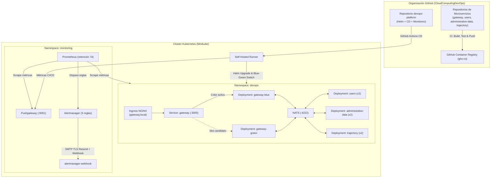

# Guía Paso a Paso Reproducible y Guion de Demostración

Esta guía permite reproducir de principio a fin la plataforma **CloudComputingDevOps** en menos de 60 minutos (criterio de aceptación **R1.8**) y sirve como guion estructurado para grabar o sustentar cada subpunto del proyecto (**R1.1 a R1.7**).

---

## 1. Arquitectura General del Sistema



---

## 2. Prerrequisitos y Preparación del Entorno

### 2.1 Requisitos de Hardware y Sistema Operativo
- **Sistema Operativo**: Ubuntu 22.04+ LTS (nativo o máquina virtual con mínimo **4 vCPU** y **8–12 GB RAM**).
- **Herramientas requeridas**: `docker`, `minikube`, `kubectl`, `helm`, `git`, `curl`, `wrk`, `k6`.

### 2.2 Instalación de Herramientas (si el entorno está limpio)

```bash
# 1. Dependencias del sistema y wrk
sudo apt-get update
sudo apt-get install -y curl git gettext-base wrk apt-transport-https ca-certificates gnupg

# 2. Docker
curl -fsSL https://get.docker.com | sudo sh
sudo usermod -aG docker "$USER"
sudo systemctl enable --now docker

# 3. kubectl
curl -LO "https://dl.k8s.io/release/$(curl -L -s https://dl.k8s.io/release/stable.txt)/bin/linux/amd64/kubectl"
sudo install -o root -g root -m 0755 kubectl /usr/local/bin/kubectl && rm -f kubectl

# 4. Minikube
curl -LO https://storage.googleapis.com/minikube/releases/latest/minikube-linux-amd64
sudo install minikube-linux-amd64 /usr/local/bin/minikube && rm -f minikube-linux-amd64

# 5. Helm 3
curl https://raw.githubusercontent.com/helm/helm/main/scripts/get-helm-3 | bash

# 6. k6 (para pruebas de carga R1.7)
sudo gpg -k
sudo gpg --no-default-keyring --keyring /usr/share/keyrings/k6-archive-keyring.gpg \
  --keyserver hkp://keyserver.ubuntu.com:80 \
  --recv-keys C5AD17C747E3415A3642D57D77C6C491D6AC1D69
echo "deb [signed-by=/usr/share/keyrings/k6-archive-keyring.gpg] https://dl.k6.io/deb stable main" \
  | sudo tee /etc/apt/sources.list.d/k6.list
sudo apt-get update && sudo apt-get install -y k6
```

---

## 3. Puesta en Marcha del Sistema Completo (Paso a Paso)

### Paso 1 — Clonar el repositorio y configurar credenciales (Secrets)

```bash
git clone https://github.com/CloudComputingDevOps/devops-platform.git
cd devops-platform
chmod +x scripts/*.sh scripts/load/*.sh scripts/failures/*.sh
```

Crear los archivos de secretos locales a partir de las plantillas de `secrets/examples/` (estos archivos están ignorados por Git y también se copian a `~/secrets/devops` para el runner de CD):

```bash
mkdir -p secrets/devops ~/secrets/devops
chmod 700 secrets secrets/devops ~/secrets ~/secrets/devops

# Si aún no existen, copiar desde las plantillas y completar valores reales:
cp -n secrets/examples/administrative-data.env.example secrets/devops/administrative-data.env
cp -n secrets/examples/users.env.example               secrets/devops/users.env
cp -n secrets/examples/trajectory.env.example          secrets/devops/trajectory.env
cp -n secrets/examples/alertmanager.env.example        secrets/devops/alertmanager.env

# Sincronizar con ~/secrets/devops para el Self-Hosted Runner:
cp secrets/devops/*.env ~/secrets/devops/
chmod 600 secrets/devops/*.env ~/secrets/devops/*.env
```

### Paso 2 — Iniciar el clúster Kubernetes (Minikube) y Addons

```bash
minikube start --driver=docker --cpus=4 --memory=8192
minikube addons enable ingress
minikube addons enable metrics-server

# Verificar que el nodo y el controlador Ingress estén listos
kubectl get nodes
kubectl wait --namespace ingress-nginx \
  --for=condition=ready pod \
  --selector=app.kubernetes.io/component=controller \
  --timeout=180s
```

### Paso 3 — Desplegar la plataforma base y Blue-Green (`deploy-stack.sh`)

```bash
./scripts/deploy-stack.sh
```

Este comando automatiza:
1. Creación del namespace `devops`.
2. Inyección de los Kubernetes Secrets (`administrative-data-secrets`, `users-secrets`, `trajectory-secrets`).
3. Instalación del broker **NATS** vía Helm (`nats://nats:4222`).
4. Despliegue del chart `helm/microservices` combinando `values.yaml` y `values-images.yaml` (2 réplicas por microservicio con `RollingUpdate` + slots `gateway-blue` y `gateway-green` + `Ingress`).

Registrar el dominio local `gateway.local` hacia la IP de Minikube:

```bash
grep -q "gateway.local" /etc/hosts \
  && sudo sed -i "s/.*gateway.local/$(minikube ip) gateway.local/" /etc/hosts \
  || echo "$(minikube ip) gateway.local" | sudo tee -a /etc/hosts
```

### Paso 4 — Instalar el stack de Monitoreo y Alertmanager (`install-monitoring.sh`)

```bash
./scripts/install-monitoring.sh
```

Este comando instala en el namespace `monitoring`:
- **Prometheus** (retención de 7 días y scrape a pods, nodos y Pushgateway).
- **Alertmanager** con las 3 reglas personalizadas (`PodCaido`, `PodCPUAlto`, `BuildFallidoConsecutivo`), salida SMTP TLS (Resend) y receptor `alertmanager-webhook`.
- **Prometheus Pushgateway** para métricas del pipeline CI/CD.
- **Grafana** base.

### Paso 5 — Activar el Self-Hosted Runner para CD automático

En una terminal (o como servicio `systemd`), mantener activo el runner registrado contra `CloudComputingDevOps/devops-platform`:

```bash
cd ~/actions-runner
./run.sh
# O en segundo plano permanente:
# sudo ./svc.sh install && sudo ./svc.sh start
```

---

## 4. Guion de Grabación por Subpuntos (R1.1 a R1.7)

A continuación se detalla **qué mostrar en pantalla y qué comandos ejecutar** al grabar cada requerimiento de la rúbrica.

---

### Subpunto 1 — Flujo Git y CI en Repositorios de Microservicios (`R1.1` y `R1.2` — Integrante 1)

**Qué mostrar en el video:**
1. Abrir en GitHub la organización `CloudComputingDevOps` y mostrar los 5 repositorios (`gateway`, `users-microservice`, `administrative-data-microservice`, `trajectory-microservice`, `devops-platform`).
2. Mostrar las ramas (`main`, `develop`, ramas de feature) y un **Pull Request** aprobado.
3. Entrar a la pestaña **Actions** de uno de los microservicios (ej. `gateway`) y mostrar el pipeline de CI ejecutando:
   - Instalación y compilación (`build`)
   - Ejecución de pruebas (`test`)
   - Construcción de imagen Docker y publicación en **GHCR** (`ghcr.io/cloudcomputingdevops/gateway:sha-...`) en menos de 10 minutos.

---

### Subpunto 2 — Infraestructura Base, Helm y Rolling Update (`R1.3` — Integrante 2)

**Qué mostrar en el video (en la terminal):**

1. **Verificar clúster, NATS, Secrets y pods con 2 réplicas en `Running`:**
   ```bash
   kubectl get nodes -o wide
   helm list -n devops
   kubectl get secrets -n devops
   kubectl get deployments,pods,svc -n devops -o wide
   ```
   *Explicación*: señalar que `users`, `administrative-data` y `trajectory` corren con `2/2` réplicas listas y `nats-0` provee la mensajería interna en el puerto `4222`.

2. **Probar comunicación funcional HTTP → Gateway → NATS → Microservicio → Supabase:**
   ```bash
   curl -i http://gateway.local/api/areas
   curl -i http://gateway.local/api/users
   ```
   *(Si en tu red Docker local el Ingress requiere túnel, en otra terminal abre `kubectl -n devops port-forward svc/gateway 3000:3000` y prueba con `http://127.0.0.1:3000/api/areas`).*

3. **Demostrar Rolling Update sin downtime y Rollback automático con Helm:**
   ```bash
   # Ver historial de revisiones de Helm
   helm history microservices -n devops

   # Ejecutar actualización declarativa con RollingUpdate (maxUnavailable: 0, maxSurge: 1)
   helm upgrade microservices ./helm/microservices \
     --namespace devops \
     -f ./helm/microservices/values.yaml \
     -f ./helm/microservices/values-images.yaml \
     --wait

   # Demostrar rollback inmediato a la revisión previa si se requiere
   helm rollback microservices 1 -n devops --wait
   kubectl get pods -n devops
   ```

---

### Subpunto 3 — Pipeline CD Automatizado y Despliegue Blue-Green con Ingress (`R1.7` — Integrante 3)

**Qué mostrar en el video:**

#### Escenario A: Estado inicial de la arquitectura Blue-Green e Ingress
```bash
./scripts/blue-green-switch.sh status
```
*Explicación en cámara*:
- Existen dos Deployments activos al mismo tiempo: `gateway-blue` y `gateway-green`.
- El recurso `Ingress` (`gateway.local`) envía todo el tráfico al Service `gateway`.
- El Service `gateway` tiene el selector `version: blue` (todo el tráfico de usuarios va a `blue`, mientras `green` está listo en espera).

#### Escenario B: Despliegue Continuo (CD) desde GitHub Actions
1. Abrir en el navegador GitHub → `CloudComputingDevOps/devops-platform` → **Actions** → workflow **CD - Deploy & Blue-Green Release**.
2. Hacer clic en **Run workflow** (o hacer `git push` tras cambiar un tag en `helm/microservices/values-images.yaml`):
   - Seleccionar `strategy: blue-green`.
3. Mostrar en vivo cómo:
   - Corre el Job 1 (`1. Lint & Render Helm Charts`) en GitHub Cloud.
   - El **Self-Hosted Runner** toma el Job 2 (`2. Continuous Delivery`), despliega la nueva versión en el slot inactivo (`green`), verifica que los pods pasen las sondas `readinessProbe`, conmuta el tráfico automáticamente a `green` y reporta las métricas al Pushgateway.

#### Escenario C: Prueba de carga (`k6` y `wrk`) durante el switch Blue-Green (Cero pérdida de requests)
Ejecutar en la terminal el script que bombardea el Gateway durante 60 segundos y a los 20 segundos conmuta el tráfico entre `blue` y `green`:

```bash
mkdir -p docs/evidencias

# 1. Prueba Blue-Green bajo carga con k6
./scripts/load/blue-green-during-load.sh green | tee docs/evidencias/r1.7-blue-green-k6.txt

# 2. Prueba adicional de concurrencia con wrk
./scripts/load/run-wrk.sh | tee docs/evidencias/r1.7-wrk.txt
```
*Qué señalar en el resultado final de k6/wrk*:
- En `t=20s` aparece en consola `Color actual: blue -> green` y el Service cambia sus endpoints en caliente.
- Al terminar la prueba, mostrar que no hay errores de conexión (`connection refused` = 0, todas las peticiones recibieron respuesta HTTP del Gateway sin interrupción).

---

### Subpunto 4 — Sistema de Alertas en Alertmanager y Fallos Simulados (`R1.6` — Integrante 3)

**Preparación antes de grabar este subpunto (dejar abiertas 2 terminales auxiliares y el navegador):**

- **Terminal auxiliar 1 (Port-forward de Prometheus y Alertmanager)**:
  ```bash
  kubectl -n monitoring port-forward svc/monitoring-kube-prometheus-prometheus 9090:9090 &
  kubectl -n monitoring port-forward svc/monitoring-kube-prometheus-alertmanager 9093:9093 &
  ```
  Abrir en el navegador:
  - Prometheus Alerts: `http://localhost:9090/alerts`
  - Alertmanager UI: `http://localhost:9093`
  - Panel de **Resend (Emails)** o bandeja de `notificaciones@devcorebits.com`.

- **Terminal auxiliar 2 (Logs en vivo del receptor de notificaciones)**:
  ```bash
  kubectl -n monitoring logs deploy/alertmanager-webhook -f
  ```

En la **terminal principal**, verificar primero que las 3 reglas están cargadas en el clúster:
```bash
kubectl get prometheusrule -n monitoring | grep devops
```

#### Prueba de Alerta 1 — `PodCaido` (Caída de servicio en `devops`)
```bash
# Provocar caída (escala el deployment users a 0 réplicas)
./scripts/failures/simulate-failures.sh pod-down
```
1. Esperar ~1 minuto y refrescar `http://localhost:9090/alerts` → mostrar `PodCaido` pasando de **Pending** a **FIRING**.
2. Mostrar la alerta activa en Alertmanager (`http://localhost:9093`), el JSON recibido en la **Terminal auxiliar 2** (`alertmanager-webhook`) y el correo `[DevOps] FIRING: PodCaido` enviado a `notificaciones@devcorebits.com`.
3. Restaurar el servicio:
   ```bash
   ./scripts/failures/simulate-failures.sh restore-pod-down
   ```

#### Prueba de Alerta 2 — `PodCPUAlto` (Consumo de CPU > 80% del límite)
```bash
# Inyectar carga intensiva de CPU en gateway-blue
./scripts/failures/simulate-failures.sh cpu-stress
```
1. Esperar ~2 minutos mientras Prometheus evalúa la tasa de CPU frente al límite de `200m`.
2. Mostrar en `http://localhost:9090/alerts` y `http://localhost:9093` la alerta `PodCPUAlto` en estado **FIRING**, junto con su notificación por correo/webhook.
3. Detener el estrés de CPU:
   ```bash
   ./scripts/failures/simulate-failures.sh restore-cpu-stress
   ```

#### Prueba de Alerta 3 — `BuildFallidoConsecutivo` (Fallos consecutivos en el pipeline CI/CD)
```bash
# Simular 2 fallos consecutivos reportados en Pushgateway
./scripts/failures/simulate-failures.sh build-fail
```
1. Esperar ~1 minuto y mostrar en Prometheus/Alertmanager la alerta `BuildFallidoConsecutivo` (`cicd_pipeline_consecutive_failures > 1`) en estado **FIRING** y el correo recibido.
2. Restaurar la métrica del pipeline a estado saludable (`0` fallos):
   ```bash
   ./scripts/failures/simulate-failures.sh restore-build-fail
   ```

Guardar el registro consolidado de notificaciones para el repositorio:
```bash
kubectl -n monitoring logs deploy/alertmanager-webhook --tail=200 > docs/evidencias/r1.6-alertas-notificaciones.txt
```

---

## 5. Resumen de Comandos de Verificación Rápida

| Verificación | Comando |
| --- | --- |
| Estado de pods y servicios (`devops`) | `kubectl get deploy,pods,svc,ingress -n devops -o wide` |
| Color activo Blue-Green | `./scripts/blue-green-switch.sh status` |
| Liberación Blue-Green de nueva imagen | `./scripts/blue-green-release.sh <sha-tag>` |
| Estado de Prometheus y Alertmanager | `kubectl get pods,prometheusrule -n monitoring` |
| Historial de notificaciones recibidas | `kubectl -n monitoring logs deploy/alertmanager-webhook --tail=100` |
