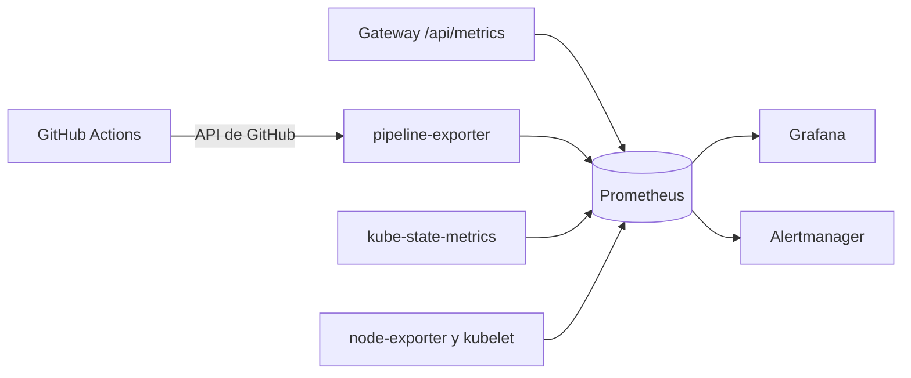

# Monitoreo: Prometheus y Grafana (R1.4 y R1.5)

Esta carpeta contiene el monitoreo de la plataforma. Cubre dos requerimientos:

| Requerimiento | Qué se entrega | Criterio de aceptación |
| --- | --- | --- |
| R1.4 | Prometheus con métricas de pods, nodos y pipeline | Métricas en tiempo real, retención de 7 días |
| R1.5 | Dashboard de Grafana con 12 paneles | Exportado como JSON en `grafana/dashboards/` |

## Cómo funciona



| Métrica | De dónde sale |
| --- | --- |
| CPU y memoria por pod | kubelet (cAdvisor), incluido en el chart |
| Estado y reinicios de pods | kube-state-metrics, incluido en el chart |
| Nodos | node-exporter, incluido en el chart |
| Latencia y errores HTTP | El Gateway expone `/api/metrics` (ver `gateway-metrics/`) |
| Duración y éxito de los builds | `pipeline-exporter`, que consulta la API de GitHub |

Los workflows corren en runners de GitHub y no pueden llegar al clúster de Minikube dentro de la VM. Por eso el exportador trabaja al revés: desde el clúster consulta la API de GitHub y publica los resultados para Prometheus.

## Archivos

```text
monitoring/
├── kube-prometheus-stack/
│   └── values.yaml                    # Valores base del chart, Alertmanager y reglas (R1.6)
├── prometheus/
│   ├── values.yaml                    # Valores adicionales de R1.4 y R1.5 (disco, sidecar de dashboards)
│   ├── servicemonitor-gateway.yaml    # Recolección de métricas del Gateway
│   └── pipeline-exporter/
│       ├── exporter.py                # Exportador de métricas del pipeline
│       └── pipeline-exporter.yaml     # Deployment, Service y ServiceMonitor
├── grafana/
│   └── dashboards/devops-platform.json
├── gateway-metrics/
│   └── gateway-metrics.patch          # Cambio que se aplica en el repo Gateway
├── alertmanager-webhook/              # Receptor local de alertas (R1.6)
└── pushgateway/                       # Métricas empujadas por el pipeline de CD (R1.6)
```

Prometheus, Grafana y Alertmanager se instalan una sola vez, con el chart `kube-prometheus-stack`. El script le pasa a Helm primero `kube-prometheus-stack/values.yaml` y después `prometheus/values.yaml`, así que el segundo archivo solo contiene lo que R1.4 y R1.5 agregan.

## Instalación

Requisitos: Minikube encendido, `kubectl` y Helm, y la aplicación desplegada en el namespace `devops` (ver el README principal).

1. Crear un token de GitHub (opcional pero recomendado). En GitHub: Settings, Developer settings, Personal access tokens, Tokens (classic), Generate new token. Si los repositorios de los microservicios son públicos no necesita ningún permiso marcado; si son privados hay que marcar el permiso `repo`, porque de lo contrario la API responde 404. Sin token, GitHub solo permite 60 consultas por hora y el exportador se actualiza cada 10 minutos en lugar de cada minuto.

2. Ejecutar el script desde la raíz del repo:

```bash
export GITHUB_TOKEN=ghp_REEMPLAZAR
bash scripts/install-monitoring.sh
```

El token se guarda como Secret de Kubernetes y no queda en el repositorio.

3. Abrir Grafana y Prometheus (cada comando en una terminal distinta):

```bash
kubectl -n monitoring port-forward --address 0.0.0.0 svc/monitoring-grafana 3001:80
kubectl -n monitoring port-forward --address 0.0.0.0 svc/monitoring-kube-prometheus-prometheus 9090:9090
```

- Grafana: http://192.168.100.3:3001 (usuario `admin`, clave `admin`, definida en `kube-prometheus-stack/values.yaml`)
- Prometheus: http://192.168.100.3:9090

El dashboard aparece en Grafana como "Plataforma DevOps: aplicación y pipeline".

## Verificación

```bash
kubectl -n monitoring get pods
kubectl -n monitoring get pvc
kubectl -n monitoring get prometheus -o jsonpath='{.items[0].spec.retention}{"\n"}'
```

- Todos los pods deben quedar en `Running`.
- El PVC de Prometheus debe estar `Bound`. Es lo que conserva los datos si el pod se reinicia.
- El último comando debe imprimir `7d`.

En Prometheus, la página Status > Targets debe mostrar en estado `UP` los targets `pipeline-exporter` y `gateway`. Consultas rápidas para comprobar que hay datos:

```promql
ci_workflow_success_ratio
ci_workflow_last_run_duration_seconds
sum by (pod) (rate(container_cpu_usage_seconds_total{namespace="devops", container!=""}[5m]))
http_requests_total
```

## Métricas del Gateway

Los paneles de latencia y errores HTTP necesitan que el Gateway exponga métricas. El cambio está en `gateway-metrics/gateway-metrics.patch` y agrega un módulo de NestJS con `prom-client`. Se integra por pull request, igual que cualquier otro cambio:

```bash
# Dentro del repo Gateway
git checkout develop && git pull
git checkout -b feature/metrics-prometheus
npm install prom-client@^15.1.3
git apply --ignore-whitespace /ruta/a/devops-platform/monitoring/gateway-metrics/gateway-metrics.patch
npm test
npm run build
git add -A
git commit -m "feat: exponer metricas de Prometheus en /api/metrics"
git push -u origin feature/metrics-prometheus
```

Después se abre el PR hacia `develop`. Cuando el pipeline publique la imagen nueva, se actualiza el tag del Gateway en `helm/microservices/values.yaml` y se ejecuta `helm upgrade`. Para comprobarlo:

```bash
kubectl -n devops port-forward svc/gateway 3000:3000
curl -s http://localhost:3000/api/metrics | grep http_requests_total
```

## Paneles del dashboard

| Sección | Paneles |
| --- | --- |
| Resumen | Pods en ejecución, reinicios, errores 5xx, éxito del pipeline |
| Recursos por pod | CPU por pod, memoria por pod |
| Aplicación | Latencia p50/p95/p99, tasa de errores HTTP, peticiones por segundo |
| Pipeline CI | Duración de los builds, tasa de éxito por repositorio, último build |

## Actualizar el JSON del dashboard

Si el dashboard se edita desde Grafana, hay que exportarlo de nuevo para que el repo quede igual:

1. En el dashboard: Share > Export > Export as JSON, con la opción "Export for sharing externally" desactivada.
2. Reemplazar `monitoring/grafana/dashboards/devops-platform.json` con ese contenido.
3. Ejecutar otra vez `bash scripts/install-monitoring.sh` y subir el cambio por PR.

## Métricas del pipeline disponibles

| Métrica | Significado |
| --- | --- |
| `ci_workflow_last_run_duration_seconds` | Duración del último build |
| `ci_workflow_avg_duration_seconds` | Duración promedio de los últimos 30 builds |
| `ci_workflow_success_ratio` | Fracción de builds exitosos (0 a 1) |
| `ci_workflow_last_run_success` | 1 si el último build pasó, 0 si falló |
| `ci_workflow_consecutive_failures` | Builds fallidos seguidos |
| `ci_workflow_runs` | Cantidad de builds por resultado |

La alerta de "build fallido consecutivo" de R1.6 usa hoy `cicd_pipeline_consecutive_failures`, que el pipeline de CD envía al Pushgateway. `ci_workflow_consecutive_failures` da el mismo dato por repositorio, leído desde GitHub, y puede usarse como alternativa con la expresión `ci_workflow_consecutive_failures >= 2`.

## Problemas frecuentes

| Síntoma | Qué revisar |
| --- | --- |
| El target `gateway` no aparece | Que el Service tenga la etiqueta `app=gateway`: `kubectl -n devops get svc gateway --show-labels` |
| El target `gateway` está `DOWN` con error 404 | La imagen desplegada todavía no incluye el módulo de métricas |
| Paneles del pipeline vacíos | `kubectl -n monitoring logs deploy/pipeline-exporter` |
| `ci_exporter_up` en 0 | Límite de la API de GitHub o token inválido |
| El PVC queda `Pending` | `kubectl get storageclass`; en Minikube debe existir `standard` |
| El dashboard no aparece | `kubectl -n monitoring get configmap -l grafana_dashboard=1` |
